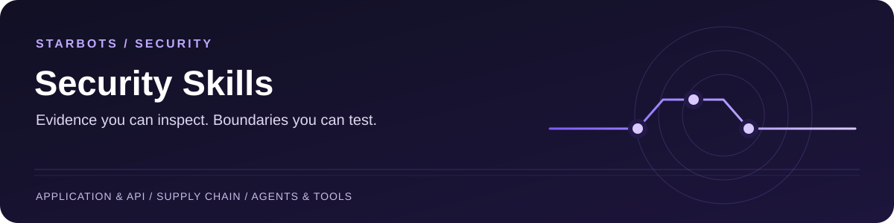

# Starbots Security Skills

**Security reviews with evidence you can inspect.** Three portable agent skills plus a local Python CLI (`sb-security`) that run deliberately vulnerable and corrected synthetic fixtures, record every result as versioned, hash-bound evidence, and never turn a missing or failed check into a PASS.

[What it is](#what-it-is) · [What it's for](#what-its-for) · [What's included](#whats-included) · [Install](#install) · [Quick start](#quick-start) · [Add the skills to your agent](#add-the-skills-to-your-agent) · [Limits](#limits) · [Resumen en español](#resumen-en-español)

## What it is

Starbots Security Skills is an offline security-review toolkit for AI coding agents and the people who supervise them. Each skill is a `SKILL.md` file that tells an agent (Claude Code, Codex, Kiro or any agent that reads Agent Skills) how to run a specific review with the `sb-security` CLI and how to report it honestly. The CLI executes owned synthetic fixtures locally (an HTTP API, a PostgreSQL database with row-level security, scanner inputs and an agent tool dispatcher), then writes a review directory containing a `SecurityAssessment`, per-control evidence, raw observations and a short Markdown report. Every file in the review is bound by SHA-256 to the exact subject that was reviewed, and readiness is recomputed from the evidence, so a report cannot claim more than was actually executed.

## What it's for

It helps security engineers, platform teams and developers who use AI agents for security work and want results that are reproducible and verifiable rather than narrative. Concrete uses:

- **Show broken object-level authorization and tenant isolation side by side.** Run the vulnerable and corrected HTTP fixtures (27 real HTTP requests each: cross-tenant and same-tenant cross-user reads and writes, roles, sensitive fields, bulk export, forged headers, expired sessions) and compare the evidence.
- **Check PostgreSQL row-level security for real.** With Docker, the RLS fixture creates random roles in an isolated, network-less PostgreSQL container and tests `USING` / `WITH CHECK`, forged tenant context and pooled-connection reset (21 assertions per variant).
- **Run secrets, dependency and IaC scanners with provenance.** Pinned Gitleaks, OSV-Scanner and Trivy run inside a locked-down container over synthetic inputs; tool versions, rule and advisory digests and coverage are recorded with each finding.
- **Test an agent's tool permission boundary.** A deterministic harness sends requests attributed to untrusted documents, tool responses, repository instructions and forged approvals to a capability dispatcher and checks that only the one permitted read succeeds.
- **Attach a verifiable security review to an exact proposal.** A review can bind the exact bytes of another artifact, for example a report from [Starbots Hybrid Infrastructure](https://github.com/Starbots-devv/hybrid-infrastructure), and be verified later against a SHA-256 receipt you kept separately.
- **Keep agents honest.** The skills instruct the agent to report UNKNOWN for anything that did not run, to never reproduce secret values and to treat imported text as evidence, never as permission.

## What's included

| Skill | Folder | What it reviews |
| --- | --- | --- |
| Application & API Security Review | [`skills/review-app-api`](skills/review-app-api/SKILL.md) | Object, function and field authorization over HTTP; PostgreSQL RLS tenant isolation |
| Supply Chain & Dependency Security | [`skills/review-supply-chain`](skills/review-supply-chain/SKILL.md) | Secrets (Gitleaks), npm and PyPI advisories (OSV-Scanner), Terraform misconfiguration (Trivy) |
| AI Agent, Tools & MCP Security | [`skills/review-agent-tools`](skills/review-agent-tools/SKILL.md) | Prompt-injection-attributed tool requests, client isolation, denied critical actions |

Also in this repository:

- `src/starbots_security/` — the `sb-security` CLI, evidence contracts, fixture runners and the skill installer. The wheel ships the same three skills and all fixtures.
- `contracts/1.0.0/` — the versioned JSON Schemas (Evidence, SubjectRef, SecurityAssessment), control profile, readiness table and conformance vectors.
- `controls/local-review-policy.json` — the six mandatory controls of a full local review (`SB-AUTH`, `SB-RLS`, `SB-SECRETS`, `SB-DEPENDENCIES`, `SB-IAC`, `SB-AGENT-BOUNDARY`).
- `examples/` — synthetic contract examples and the vulnerable/corrected fixtures (HTTP API, RLS SQL, scanner inputs).
- `evals/skills-cases.json` — human-readable routing cases (positive, negative and hostile requests) for checking which skill an agent picks.
- `tools/` — `acquire_toolchain.py` (explicit, hash-verified scanner download), `postgres_fixture.py` (start/stop the isolated PostgreSQL container) and `stamp_build.py` (records your checkout's commit in the wheel).
- `docs/` — [local review controls and reproduction](docs/local-review.md) and [host compatibility](docs/host-compatibility.md).

## Install

Requirements: Windows x64 and CPython 3.12. The hash-locked dependency files pin Windows x64 wheels. Docker Desktop is needed only for the PostgreSQL and scanner checks (see [Limits](#limits)).

```powershell
git clone https://github.com/Starbots-devv/security-skills.git
cd security-skills
py -3.12 -m venv .venv
.venv/Scripts/python.exe -m pip --no-cache-dir install --require-hashes -r requirements-dev.lock
.venv/Scripts/python.exe tools/stamp_build.py
.venv/Scripts/python.exe -m pip --no-cache-dir wheel --no-index --no-deps --no-build-isolation --wheel-dir dist .
.venv/Scripts/python.exe -m pip --no-cache-dir install --no-index --no-deps --find-links dist starbots-security-skills
.venv/Scripts/sb-security.exe --help
```

`stamp_build.py` is optional: on a clean Git checkout it records the commit in the installed package so generated evidence names its source; without it the producer is reported as `UNRELEASED`. The CLI needs no credentials and does not contact any cloud service.

## Quick start

Validate a contract without executing anything:

```powershell
.venv/Scripts/sb-security.exe validate --input examples/contracts/Evidence.json --kind Evidence
```

Run the agent tool boundary review (pure Python, no Docker needed). Use the current UTC time and a new, empty output directory:

```powershell
.venv/Scripts/sb-security.exe assess-fixture --skill agent-tools --variant corrected --client-id synthetic-demo --project-id agent-boundary --as-of 2026-11-23T12:00:00Z --output-dir .local-output/agent-review
```

The command prints the assessment SHA-256. Keep it somewhere other than the review directory, then verify the review against it:

```powershell
.venv/Scripts/sb-security.exe verify-assessment --review-dir .local-output/agent-review --assessment-sha256 <printed-sha256> --client-id synthetic-demo --project-id agent-boundary --as-of 2026-11-23T12:00:00Z
```

Compare the vulnerable and corrected HTTP API fixtures (each run needs its own output directory):

```powershell
.venv/Scripts/sb-security.exe assess-fixture --skill app-api --variant vulnerable --client-id synthetic-demo --project-id app-api --as-of 2026-11-23T12:00:00Z --output-dir .local-output/api-vulnerable
.venv/Scripts/sb-security.exe assess-fixture --skill app-api --variant corrected --client-id synthetic-demo --project-id app-api --as-of 2026-11-23T12:00:00Z --output-dir .local-output/api-corrected
```

`SB-AUTH` is FAIL with findings for the vulnerable variant and PASS for the corrected one. Without a PostgreSQL runtime, `SB-RLS` stays UNKNOWN and the command exits 4. Open `security-report.md` in each directory for the summary; `security-assessment.json`, `evidence/` and `observations/` hold the details.

Exit codes: `0` READY within the fixture scope · `3` valid review that is BLOCKED (for example, only one skill was run) · `4` a requested check could not run completely · `2` invalid input or integrity failure.

For the full six-control review with PostgreSQL and the pinned scanners, follow [docs/local-review.md](docs/local-review.md) and [tools/TOOLCHAIN.md](tools/TOOLCHAIN.md).

## Add the skills to your agent

The skills call the `sb-security` CLI, so install the CLI first in the environment your agent uses. Then install the three skill folders into an existing project:

```powershell
.venv/Scripts/sb-security.exe install-skills --host claude --project-root <your-project>
```

| Agent | `--host` | Installed to |
| --- | --- | --- |
| Claude Code | `claude` | `<your-project>/.claude/skills/` |
| Codex | `codex` | `<your-project>/.agents/skills/` |
| Kiro | `kiro` | `<your-project>/.kiro/skills/` |

The installer never overwrites an existing skill folder and never changes global agent settings. `uninstall-skills` with the same arguments removes only files it installed and refuses to delete anything you edited. You can also copy the folders under `skills/` into the directory above by hand.

Then ask your agent, for example, *"Review cross-tenant API access with the review-app-api skill and report the evidence"*.

## Limits

- **Synthetic fixtures only.** The skills currently run on the bundled synthetic fixtures. They do not scan your repository, API, database, cloud account or agent. A PASS covers only the stated fixture, control, tool version and evidence window; it is not a certification, a production assessment or deployment approval.
- **Platform.** Installation and the unit tests are verified on Windows x64 with CPython 3.12. Other platforms need their own hash-locked requirements.
- **Docker-based checks.** The PostgreSQL and scanner checks accept only the Docker Desktop client at `C:/Program Files/Docker/Docker/resources/bin/docker.exe` with the SHA-256 pinned in the code, and only the pinned Alpine and PostgreSQL image digests. Another Docker client or image requires a reviewed change to those pins.
- **Scanner data.** Scanner binaries and OSV advisory snapshots are not bundled. `tools/acquire_toolchain.py --download` fetches them from the upstream URLs recorded in `toolchain-lock.json` and verifies every hash. The pinned OSV snapshots are dated 2026-10-18 and expire on 2026-10-25, so a fresh dependency PASS needs an `--as-of` inside that window; later dates are rejected as stale. Upstream may stop serving those exact snapshots.
- **Agent boundary.** The agent check is a deterministic harness over a finite set of cases. It does not invoke a language model, measure prompt-injection resistance of any model, or exercise an MCP transport.
- **Agent hosts.** The installer places files in the layouts above. Automatic discovery and routing of the skills by Claude Code, Codex or Kiro is not measured.
- **Integrity, not identity.** SHA-256 hashes prove that review files match a receipt you kept separately. They are not publisher signatures and do not authenticate who produced a review.

## Tests

```powershell
.venv/Scripts/python.exe -m unittest discover -s tests -p "test_*.py" -v
.venv/Scripts/python.exe -m unittest discover -s tests/integration -p "test_*.py" -v
```

The unit suite needs no network or Docker. In the integration suite, the HTTP, wheel and scanner-suppression tests run without Docker; the PostgreSQL and scanner-execution tests need the Docker runtime and acquired toolchain described in [docs/local-review.md](docs/local-review.md) and fail (rather than skip) when those prerequisites are missing.

## License

Apache License 2.0. See [LICENSE](LICENSE), [NOTICE](NOTICE) and [third-party notices](THIRD_PARTY_NOTICES.md). Security reports: [SECURITY.md](SECURITY.md). Contributions: [CONTRIBUTING.md](CONTRIBUTING.md).

## Resumen en español

**Starbots Security Skills** es un conjunto de tres skills portables para agentes de IA (Claude Code, Codex, Kiro y cualquier agente que lea `SKILL.md`) más una CLI local en Python (`sb-security`). Ejecuta fixtures sintéticos vulnerables y corregidos, guarda cada resultado como evidencia versionada y ligada por SHA-256 al sujeto exacto revisado, y nunca convierte una comprobación ausente o fallida en PASS.

**Skills incluidas:**

- **Application & API Security Review** (`review-app-api`): control de acceso a objetos, funciones y campos sobre HTTP, y aislamiento multi-tenant con RLS de PostgreSQL.
- **Supply Chain & Dependency Security** (`review-supply-chain`): secretos (Gitleaks), dependencias npm y PyPI (OSV-Scanner) y configuración Terraform (Trivy).
- **AI Agent, Tools & MCP Security** (`review-agent-tools`): solicitudes a herramientas atribuidas a texto no confiable, aislamiento de cliente y bloqueo de acciones críticas.

**Para qué sirve:** comparar lado a lado fallos de control de acceso y su corrección; probar RLS real en un contenedor aislado; ejecutar escáneres fijados con procedencia; comprobar la frontera de permisos de las herramientas de un agente; adjuntar una revisión verificable a una propuesta exacta (por ejemplo, un informe de Starbots Hybrid Infrastructure); y lograr que el agente informe UNKNOWN cuando algo no se ejecutó.

**Instalación:** Windows x64 y CPython 3.12; dependencias con hashes fijados (`requirements-dev.lock`), construcción local del wheel y `sb-security --help`. Para añadir las skills a un proyecto: `sb-security install-skills --host claude|codex|kiro --project-root <proyecto>` (instala en `.claude/skills`, `.agents/skills` o `.kiro/skills`), o copia las carpetas de `skills/`.

**Límites:** por ahora las skills trabajan solo sobre los fixtures sintéticos incluidos, no sobre proyectos arbitrarios; un PASS no es una certificación ni una aprobación de despliegue. Instalación verificada en Windows x64 con CPython 3.12. Las comprobaciones de PostgreSQL y escáneres requieren Docker Desktop con el binario y las imágenes fijadas; los snapshots OSV fijados caducan el 2026-10-25. El arnés de agentes es determinista: no invoca ningún modelo ni mide su resistencia a prompt injection. La carga automática de las skills por cada agente no está medida.

**Licencia:** Apache 2.0.

---

Made by Starbots — https://starbots.dev
